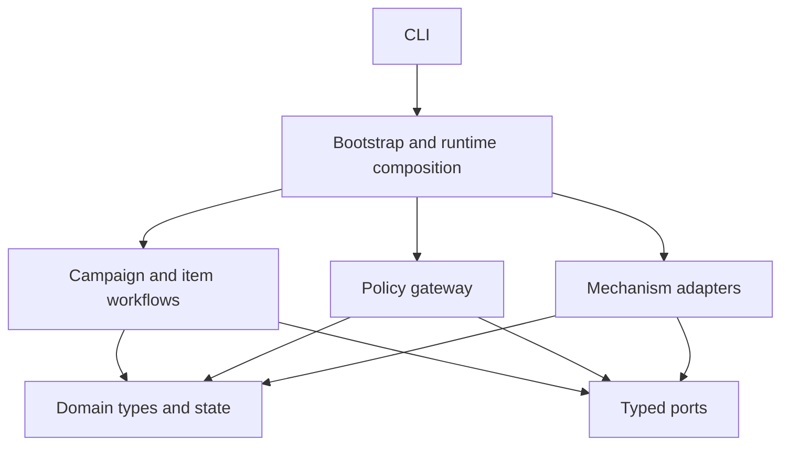
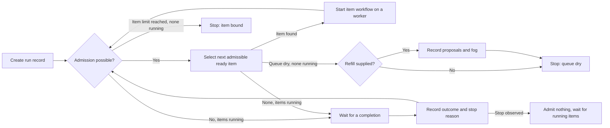

# AutoBuild architecture

This guide explains how AutoBuild keeps one build process across different coding assistants, operating systems, and trackers. It is written for readers who want to inspect, extend, or review the implementation.

The [setup and run guide](running-autobuild.md) covers installation and operation.

## Design goal

AutoBuild has one campaign sequence and one item sequence. External mechanisms sit behind typed Python interfaces called ports. Adapters implement those ports for Git, trackers, operating systems, and coding assistant commands.

The application decides what happens next. The policy layer decides whether an action is allowed. An adapter decides how to perform an allowed action.

This split keeps harness flags, shell quoting, tracker commands, and host process rules out of the workflow.

## Dependency direction



Dependencies point toward domain types and port contracts. The application layer does not import an adapter, a vendor package, `subprocess`, or platform detection.

The bootstrap package is the composition root. It is the only part that selects concrete adapters and knows which host command implementation is active.

## Package map

| Path | Responsibility |
|---|---|
| `src/autobuild/domain/` | Immutable requests, results, states, dispositions, and evidence types |
| `src/autobuild/ports/` | Protocols for each external boundary |
| `src/autobuild/application/` | Campaign loop, item workflow, prompts, and state transitions |
| `src/autobuild/enforcement/` | Deterministic policy checks around port calls |
| `src/autobuild/adapters/` | Git, tracker, harness, process, record, and knowledge mechanisms |
| `src/autobuild/bootstrap/` | Profile loading, discovery, adapter selection, and composition |
| `src/autobuild/cli.py` | Thin command-line entry point |
| `skills/autobuild-plan/` | Optional planning entry that researches, reviews and registers a queue, then stops before execution |
| `skills/autobuild/` | Optional execution entry that configures and launches the Python command |
| `tests/architecture/` | Dependency and entry-shim tripwires |
| `tests/contract/` | Shared adapter registration and result contracts |
| `tests/unit/` | Workflow and policy decisions against fakes |
| `tests/integration/` | Real processes, Git repositories, trackers, and delivery paths |

## Entry skills and executable

The Python application is the sequencing source. The `autobuild` skill supplies project facts to the command and launches it. The skill does not implement a second campaign or item workflow.

The `autobuild-plan` skill sits before execution. It researches the requested outcome, probes the riskiest step, writes a decision brief with the next slice in full and every later item in one line, has the slice reviewed, and registers the resulting queue. It stops before launch unless the owner has already authorised execution.

The repository and source archive contain both skills. The wheel contains the Python application and its `autobuild` command. Skill installation remains with the coding assistant because each host owns its skill directory and loading rules.

## Runtime composition

The CLI loads `.autobuild.toml` and applies explicit command-line overrides. Bootstrap then performs these steps:

1. Choose the Windows or POSIX command adapter from the current Python host.
2. Select [Pinax](https://github.com/antikas/pinax-tracker) or the Markdown backlog adapter from `[tracker]` and startup probes.
3. Configure the Git workspace adapter with the selected tracker's paths.
4. Resolve the selected harness through the adapter registry.
5. Choose the no-refill or Koine knowledge adapter from the refill plan.
6. Probe every selected adapter before a claim.
7. With a `[usage]` table, read the meter of every metered lane, cool each lane at its stop level until its reset, and refuse the launch when every lane is at its stop level.
8. Record adapter identities and versions in the run manifest.
9. Wrap the adapters with policy-enforced port implementations.
10. Start the campaign runner with one immutable `WorkflowPorts` object.

Explicit tracker and harness settings take precedence over discovery. Auto tracker selection prefers Pinax when it is usable, then checks the supported backlog path.

## Port contracts

The workflow calls seven semantic ports.

| Port | Workflow request | Included adapters |
|---|---|---|
| `TrackerPort` | Select, claim, close, park, and record a non-runnable proposal | Pinax and Markdown backlog |
| `WorkspacePort` | Identify a repository, create a worktree, calculate a diff, commit, integrate and deliver, and release | Git worktree adapter |
| `HarnessPort` | Probe, invoke a fresh seat, cancel it, and collect usage | Claude Code, Codex, and GitHub Copilot CLI |
| `CommandPort` | Run the approved validator with captured output and process-tree control | Windows and POSIX process adapters |
| `RunRecordPort` | Create a run, append events, write evidence, and complete a report | Local filesystem records |
| `KnowledgePort` | Retrieve durable context and record unresolved directions | Koine or no-refill adapter |
| `ProgressPort` | Begin a run stream and emit one plain-language line per event | File, stderr, and command hook progress adapters |

`TrackerProjectionPort` is an optional declaration a tracker adapter makes when it generates projection files from an event log. The workspace adapter uses it during delivery to settle a merge conflict confined to those files. Pinax declares it; the Markdown backlog does not, so a backlog conflict is a real conflict.

Two further ports serve lane routing. `LaneStatePort` keeps the machine-local lane cooling shared across campaigns. `UsageMeterPort` reads a usage meter by the opaque id a harness adapter declares and returns a normalised `UsageReading`; it never raises and its readings carry no credential. Its adapters are the Claude subscription meter, a null meter whose readings always fail, and a scripted fake. Bootstrap supplies a meter only when the profile has a `[usage]` table.

`HostResourcePort` reads the host once over a sample window and returns a `HostReading`: logical CPUs, CPU busy percent, total and available memory, and the commit limit with the headroom under it. A field the host cannot measure is null, and the reading carries a diagnostic; the port never raises. Its adapters read kernel32 system times and memory status on Windows, `/proc` on Linux, and only the CPU count elsewhere; the shared fakes add a scripted host and a null host. Bootstrap chooses the adapter as it chooses the command adapter. The capacity rule has one owner, `derive_capacity` in `enforcement/capacity.py`, which turns a reading and the profile's `CapacityPolicy` into item and heavy-command concurrency. The `autobuild host` command prints both.

The level rule has one owner, `UsagePolicy` in the domain layer. It judges a reading and returns the unscoped limits that stop a lane with the latest of their resets, the model-scoped limits that stop only covered seats, the limits at the warning level, and any reason the reading cannot be used. The launch preflight and the item workflow both call it. The item workflow reads the meter before each seat on a metered lane: an unscoped stop cools the lane through the same lane signal path a harness limit uses, with the meter's reset time; a model-scoped stop sends only that seat past the lane for that one seat, without cooling the lane and without moving the item's lane position.

A good meter reading is shared by every seat on its lane for 60 seconds, measured on a clock injected through `WorkflowPorts.usage_clock`. When it has aged out, one seat fetches the next reading while concurrent seats keep judging the previous one; a seat waits only when the lane has no good reading yet. A failed reading is never shared. Every seat still judges the reading against the levels before it starts.

Ports exchange dataclasses and enums. Vendor JSON, command flags, and shell strings remain inside adapters.

## Campaign state

The campaign runner owns an admission loop over worker threads:



Interrupted claims found at launch are admitted first, then new work. An admission needs the running count below the limit from `admission_limit` in `enforcement/selection.py`: the campaign concurrency, or one while the first lane's shared usage reading is at its warning level, so with nothing running an item is always admitted. Selection reads the tracker's ready items (a serial campaign reads the tracker's next item), applies the allow and exclude lists, skips items in flight, parked by a lane signature or taken by another writer, and skips an item whose exact declared paths overlap an item in flight. The overlap rule has one owner, `share_declared_path` in `enforcement/triage.py`, fed by `exact_declared_paths`, which reuses the brief's declared-paths parser and leaves out globs. Every completion (a delivery, a park or a failure) wakes the scheduler, which records it and decides again, so a dependant is admitted once its blocker has merged. No item error is a stop reason: an item that fails before its claim is skipped for the rest of the campaign, and every other item error ends only that item. A condition that blocks all work holds admissions instead: every lane cooling (from the admission check or an item's `lanes_exhausted` outcome), a tracker that is not clear after an item's tracker failure, as reported by `TrackerPort.recover`, or a ready-queue read that raised. The scheduler holds one hold at a time in its admission state, probes it on its own schedule (the earliest lane reset within 1 to 600 seconds, every 60 seconds for a pending tracker write, a 30 to 600 second backoff for an unreachable tracker or a failed read, which is probed by reading the queue again) and is woken for the next probe by a timer thread that waits on `WorkflowPorts.hold_wait` and nudges the completion queue. A tracker-lease renewal between items that raises is counted with the heartbeat's failures and never raises out of the scheduler. Ready items a tracker passes over (`TrackerPort.skipped_items`, for example an item without a brief) are recorded once each as `item.skipped`. A hold that lasts `CampaignContext.hold_limit_seconds` on `schedule_clock` is the `hold_limit` stop reason. A stop (the item bound or the hold limit) withholds admissions while the running items drain to their own terminal states. A worker always reports its completion, even when its item raised, so no failure keeps a slot or a lease.

Three locks serve the scheduler, each for its shared read or write only. The completion queue's condition covers appending and draining finished items; a worker appends after its item ends and the scheduler waits on it, so a completion is never missed and the scheduler never polls. The admission state (running items, counters, stop) is read and written by the scheduler thread alone. The tracker-lease holder's lock covers reading and replacing the grant; the lease heartbeat renews it every `lease_heartbeat_seconds` (composition passes `lease_stale_seconds / 3`) on a wait injected through `WorkflowPorts.heartbeat_wait`, and the scheduler still renews between items. No lock is held while reading the tracker, preparing a brief, starting or joining a worker, or delivering. Item durations and the makespan use `WorkflowPorts.schedule_clock`; tests inject a fake clock for both.

A campaign with a concurrency above one and a wired `WorkflowPorts.host` runs a host pressure monitor. Its sampler thread reads `HostResourcePort` every `pressure.sample_seconds`, timed with `schedule_clock` and sleeping on `WorkflowPorts.pressure_wait`, and hands each reading to `assess_pressure` in `enforcement/pressure.py`, the single owner of the pressure levels, thresholds and the one-step decreases and increases of the effective item cap, fed by the profile's `[pressure]` table as one `PressurePolicy`. The rule is pure: it takes the previous `PressureState`, the time and the reading, and returns the next state. The rule's state belongs to the sampler thread alone; the monitor's lock covers only the shared view the scheduler reads (level, cap, episode) and the seconds spent at each level, never a sample. After each reading the sampler publishes the view, tells the heavy-command slots whether heavy commands are withheld, and nudges the scheduler through the completion queue, so a level change is acted on at once. The monitor feeds the scheduler's one admission path: the effective cap is the smaller of the concurrency and the monitor's cap, and a level other than `normal` holds back an admissible item with a `pressure` wait recorded once per episode. A hold with nothing running waits for the next nudge instead of ending the campaign. The monitor stops and is joined on every exit path of the campaign, and stopping lifts its heavy-command hold; the heavy slots are also bound fresh for every campaign. It never reaches a seat or a command. A first reading with an unmeasured CPU or memory field records one warning and ends the monitor at `normal` with the static capacity. After a measured reading, an unmeasured or failing read is skipped without changing the level, cap, hold or window; the first failure of a run records `campaign.pressure_read_failed` and the third in a row `campaign.pressure_fallback`, which keeps the current values, so a failed read never raises the cap or lifts a hold. A monitor event that cannot be recorded is dropped and sampling continues. While a pressure episode's wait is recorded, the scheduler's nudges skip reading the tracker until the level changes. The completion queue's condition also covers its nudge flag and an idle flag, which `CampaignRunner.scheduler_idle` reads so a test steps its fake clock only once the scheduler has settled.

The lease heartbeat retries a failed renewal on its next beat. Three failures in a row withhold new admissions, with a `lease` wait while items run, until a renewal succeeds; the lease holder's lock also covers the failure count.

With a concurrency of one the scheduler admits one item after each completion and records no scheduling events; the golden file of the serial schedule pins that behaviour.

Refill runs only after the live queue is dry. `ProposalRef` rejects a runnable value, so an adapter cannot feed its own proposal back into the campaign as approved work.

## Item state

One item moves through a fixed state machine:

```text
ready
  -> verified
  -> claimed
  -> isolated
  -> built
  -> validated
  -> reviewed
  -> correcting or escalated when evidence requires it
  -> finalised or parked
  -> released
```

The reviewer can return `pass`, `correct`, `escalate`, or `park`. Every finding carries a `blocking` flag. A finding is blocking only when the reviewer would not merge the change under its own name. A `correct` or `escalate` verdict must carry at least one blocking finding, a `park` verdict must carry at least one finding, and a `pass` may carry non-blocking findings only. A `pass` that carries a blocking finding, or a `correct` whose findings are all non-blocking, is an invalid verdict that the application rejects and parks. The `review.completed` event records the blocking and non-blocking finding codes separately.

A correction starts another fresh builder and reviewer pair. The default ceiling is two correction rounds. An escalation starts a specialist seat for the named specialist boundary. Any final result other than `pass` parks the item.

When a `pass` carries non-blocking findings, the application still accepts and delivers the item, then records one propose-only tracker follow-up per finding. Each follow-up uses the title `Follow-up: <item-id> <code>`, the finding consequence as its question, the reviewer evidence reference in its rationale, and `docs/campaigns/<campaign-id>.md` as its brief reference. These proposals are never runnable, and the campaign report lists them under Follow-ups.

## Evidence chain

The acceptance path binds each decision to the same workspace state.

1. `WorkspacePort.diff()` calculates changed paths, content digests, a binary patch reference, a workspace revision digest, and the branch head the evidence was taken against.
2. `CommandPort.run()` executes the declared validator in that worktree.
3. `ValidationEvidence` binds the validator result and changed paths to the workspace revision.
4. The reviewer receives the brief, patch reference, and validator output reference.
5. `commit_item()` pins the branch head: it rejects a head that moved since the recorded diff and names both the recorded and the observed head commit.
6. `commit_item()` recalculates the diff and rejects a changed workspace.
7. The product commit contains only the reviewed product paths, and a named close-completeness check confirms that the whole product tree and the item's own changed paths both report a clean status, so a close cannot ship a partial tree.
8. The tracker adapter writes the close state after the product commit.
9. The tracker commit must sit immediately after the product commit.
10. Delivery merges the fetched and the local target branch into the item branch, runs the validator again when the merge brought a change that overlaps the item, pushes that exact commit, checks the remote revision, and only then fast-forwards the local target branch. The validated tree equals the pushed commit's tree in every path that overlaps the item.
11. After delivery the workspace confirms that the reported item, tracker, and merged commits exist and that the merged commit is reachable from the delivery target branch. A mismatch is a structural failure of the item, which parks from the primary checkout; the campaign goes on.

The application accepts a result only when this chain remains intact. A successful model process cannot substitute for missing validator or review evidence.

Every disposition leaves a per-item trajectory file under the run record `evidence/` directory. The trajectory lists the state history, the seat outcomes, and the final reason, and it is written for accepted, parked, and failed items alike so an unaccepted item is as legible as an accepted one.

A per-item phase marker `evidence/<item-id>-phase.json` sits beside the trajectory. It is rewritten at every state transition with the state, worktree root, branch, head commit, workspace revision, correction count, and timestamp, so the head and revision each decision ran against stay pinned to disk. Its terminal value is `closed` for an accepted item, written only after the tracker commit and delivery have both been verified, or `parked` for an unaccepted one. Both terminal values are marker-only and are not item states.

One `ItemWorkflow` can run several items at once. Each run keeps its own state machine, phase marker, seat list and lane router, including the lane its builder settled on, so a lane signal in one item never moves another item's router. Only four pieces of state are shared across the items of a campaign: the usage gate, whose warning record makes a crossing of the warning level emit one `usage.warning` event however many items see it, the list of unpublished tracker writes for the campaign report, the delivery queue, and the heavy-command slots. Each is guarded by a lock that covers only its own read or update. The heavy-command slots (`HeavySlots` in `application/item.py`) wrap every validator run AutoBuild starts: a run takes a slot up to `CampaignRef.heavy_concurrency` and starts only while the pressure level allows heavy commands. Their condition covers the counters, the tickets and the level flag; it is released while a run waits and never held while one runs, and a slot is given back by every path, including a run that raises. While the level withholds heavy commands every running ticket is marked, so a validator that then times out is run once more with an exclusive slot: it waits for every other heavy command to end and holds back new ones until it ends, and its verdict stands. The delivery queue runs deliveries one at a time in the order they asked: each takes a ticket under a condition that covers only the two ticket counters, waits for its turn with the condition released, delivers, and hands the turn on by any path. A delivery that waits records `item.delivery_waiting` with the number ahead of it. A serial run is pinned by a golden file of claim order, outcomes, progress lines and run events (`tests/unit/golden/serial_schedule.json`).

## Builder and reviewer isolation

Each harness adapter starts a new command invocation with a fresh session identifier. The builder receives write-capable tools allowed by the project profile.

The reviewer receives read-only tools and a read-only sandbox when the harness supports one. Its evidence pack excludes the builder transcript.

The shared harness result contracts contain a builder summary or a review decision with concrete findings. Harness adapters normalise vendor output into these contracts.

## Git delivery model

Tracker state and product state use separate commits.

For an accepted item:

1. The tracker adapter records the claim from the primary checkout. A self-committing tracker (Pinax) commits and publishes it in the same command.
2. The workspace adapter creates an item branch and worktree from that claimed revision.
3. The builder changes product files in the worktree.
4. The workspace adapter excludes the selected tracker paths from the product diff.
5. It creates the product commit from the reviewed path set.
6. The tracker adapter writes the done state in the worktree.
7. The workspace adapter returns the tracker commit. With Pinax, the done command made it, and the adapter verifies it is exactly one commit, directly on the product commit, touching only tracker paths. With the Markdown backlog, the workspace adapter creates it.
8. It fetches the target branch and, in the worktree, merges the fetched target and then the local target head into the item branch, each as a recorded integration merge (subject `MERGED: integrate`). A conflict confined to the tracker projection is settled by the tracker's `TrackerProjectionPort`, which Pinax implements by regenerating the projection from the merged log; any other conflict aborts the merge and raises `DeliveryParked` with `delivery_conflict`.
9. When the merge changed a path outside the tracker paths, the workspace puts the changed paths to `revalidation_decision` in `enforcement/integration.py`, the single owner of the overlap rule, with the paths of the item's own commit and the paths its brief declares. Only an overlap (the same file, the same top-level package: `apps/<x>` or `packages/<x>`, otherwise the first segment, a path a declared glob or directory covers, or any root-level file) calls the `revalidate` callback the delivery request carries; changes confined to `.ergon/`, `docs/` or Markdown files never do. Every decision goes to the request's `note_revalidation` callback, which the item workflow records as `delivery.revalidation`. The item workflow owns `revalidate`: it runs the same validator invocation on the integrated worktree. A failure raises `delivery_revalidation_failed`. The pre-push check refuses a candidate that differs from the validated tree in an overlapping path.
10. Under the primary-checkout lock it checks that the local target head is an ancestor of the candidate and merges in a gap confined to the tracker paths. A gap in any other path starts the next attempt. The local target does not move.
11. It pushes exactly that commit by refspec from the worktree and verifies the remote commit. A rejected push starts the next attempt. Source moves and rejected pushes together are bounded by three attempts; the third raises `delivery_contended`.
12. Only after the remote accepted the push does it take the lock again and fast-forward the local target to the pushed commit with `merge --ff-only`, merging tracker-only commits that landed meanwhile on top in the item branch first. The local target therefore never holds an undelivered item commit, so a later tracker write that pushes the local target cannot publish a parked item. A pushed campaign report is committed in a detached scratch worktree and follows the same order.

The item workflow parks a `DeliveryParked` item from the primary checkout, never in the worktree, so the item branch and its tracker close stay off the remote, and keeps the worktree. Head checks step over recorded integration merges: delivery and `resume_delivery_commits` find the tracker commit beneath them, and a worktree status reports that commit as `base_commit`, which a resumed finalised marker is matched against.

The integration risk a skipped revalidation leaves is caught by batch validation. The campaign scheduler counts deliveries and, after every `run.batch_validate_every` of them and once at campaign end when anything was delivered since the last trigger, asks the workspace port for a detached validation checkout of the target head (`open_validation_checkout`; the primary-checkout lock covers only reading the head and adding the worktree) and runs the validator there in a heavy slot on its own thread. A failure records `campaign.batch_validation_failed` with the commits delivered since the last green batch and starts a `batch_validation_failed` hold. The hold's probe opens the checkout with `refresh`: it fetches the remote target outside the lock and, under it, fast-forwards the local target only when the local head is an ancestor of the remote head, so the local target still holds only delivered commits. It starts a new batch only when the head has moved; only a passing batch releases the hold. Nothing is reverted.

For a parked item, AutoBuild writes and delivers a tracker-only commit. It releases the worktree without merging the unaccepted product changes.

The primary checkout must be clean before a claim and before delivery. This rule prevents AutoBuild from mixing a user's uncommitted work into a campaign.

Every local mutation of the primary checkout holds one primary-checkout lock, which composition creates once per campaign and hands to the tracker adapter and the workspace adapter. It covers a tracker claim, park or proposal on the primary (each Pinax command is one indivisible call, held with the checks of its own commit; the Markdown backlog holds it for the row update and commit), a worktree add or remove, the delivery's pre-push catch-up and its post-push fast-forward, and the report's worktree add, fast-forward and worktree remove. It is never held across AutoBuild's own fetch or push, a validator run, or the delivery's integration merge, so a claim never waits for a validator. A push that loses a race is rejected and retried rather than prevented by the lock.

## Tracker adapters

### Pinax

The Pinax adapter delegates ordering, readiness, dependencies, gates, and event folding to the `pinax` command. It requires `.ergon/` and an approved note reference for each selected item.

Pinax 0.2.1 or later commits every claim, park, close, and proposal event under `.ergon/` itself. The adapter stages or commits tracker files only to finish a partial write: Pinax exit 7 with the status `commit_refused` or `stage_failed` means the event was appended and its commit refused. The adapter then commits exactly the leftover files under `.ergon/` with Pinax's own commit subject (regenerating the projection first when `pinax verify` reports drift), up to four attempts with waits of 2, 5 and 10 seconds, each attempt holding the primary-checkout lock for that commit alone, and pushes outside the lock when the remote default branch is checked out. A write whose recovery still fails stays pending; `TrackerPort.recover` retries it and also checks that the remote answers. A claim that finds the primary checkout dirty with tracker files only commits them in the same lock hold before the claim; a locked delivery or report step in the workspace adapter that finds the same lets the lock go, runs `recover` and tries the step again, at most three times. After each command it checks that HEAD moved, every non-merge commit the command added on the first-parent chain touches tracker paths only (a merge that takes another writer's published work is not checked), and no tracker file is left uncommitted. It reads Pinax's JSON result: a claim committed on a branch Pinax does not publish is accepted in `current-branch-pr` and stops in every other mode, and a write that was not pushed is recorded as unpublished. The tracker adapter declares that it commits itself, and composition hands that declaration to the workspace adapter. An installed Pinax that leaves its change uncommitted fails the write as `tracker_environment` and names the required version. Exit 3 on a claim means another writer holds the item, and the campaign selects the next one; any other exit 4 is a `tracker_environment` failure with the cause Pinax reported; exits 1, 2, 5, 6 and 7 are `tracker_refused` failures that carry the code and Pinax's message. Each ends only the item's write; the campaign asks the tracker to recover and holds admissions while it is not clear. A refill proposal receives a Pinax proposal gate and stays outside the ready queue.

### Markdown backlog

The backlog adapter parses one Markdown table with `Item`, `Title`, `Status`, and `Brief` columns. Table order is queue order.

It updates only the selected row for claim, done, and park operations. Refill adds a `Proposed` row. The Git workspace adapter treats the configured backlog file as tracker state, so it cannot enter the product commit.

Auto mode chooses a tracker once during preflight. A campaign does not move from one operational record to another after work starts.

## Policy enforcement

The policy gateway wraps every port used by the workflow. It checks:

- repository, worktree, brief, and evidence paths against approved roots
- semantic tool permissions for every harness seat
- exact validator identity and argument vector
- command and seat timeouts against configured ceilings
- reviewer read-only access
- evidence freshness before close
- separate product and tracker commits before delivery
- protected-branch gates for claim, park, proposal, and merge operations

The public workflow does not request deployment, publication, destructive actions, or force pushes.

## Host and temporary work

The Windows and POSIX command adapters accept argument vectors. The workflow does not build shell command strings.

Each adapter captures standard output and standard error in files. Timeout and cancellation stop the process tree started for that request.

Bootstrap chooses the operating system temporary directory by default. An operator can supply another scratch root. Child processes receive temporary and package cache environment variables below that root.

Each item also gets its own temporary directories, so concurrent items never share or clear each other's files. An item's validator command runs with `TMPDIR`, `TEMP` and `TMP` under `<scratch>/items/<item-dir>`, and each harness seat runs with them under its lane's `scratch/<item-dir>`, where `<item-dir>` is the cleaned item id followed by a short hash of the raw id. Both environments set a pytest `--basetemp` beside those directories through `PYTEST_ADDOPTS`, replacing any inherited `--basetemp` and keeping the other inherited options. Package caches (uv, pip, npm, XDG and the bytecode prefix) are not split: every item keeps the shared campaign values, which those tools lock themselves. A validator command that names its own `--basetemp` on its argument vector overrides it. The values travel on each command request; the process environment is never changed per item.

## Run records

The local record adapter writes one directory per campaign:

```text
runs/<run-id>/
  manifest.json
  events.jsonl
  progress.log
  evidence/
  report.txt
```

The manifest records the workflow version, repository, harness, model names, validator, refill counts, and selected adapter identities.

Events record the item lifecycle and point to evidence files. The run record keeps decision evidence and diagnostic references. It does not place a full builder transcript in the review pack.

Progress lines are rendered from those same events by a pure function in the application layer, so a line and its event payload share one source. The composite progress adapter fans each line out to its configured sinks: a file adapter that appends to `progress.log`, a stderr adapter that flushes each line, and an optional command hook adapter that forwards each line to a human-approved command. No progress adapter raises into the workflow.

Concurrent writers share these files safely. The events log numbers each event from a counter the adapter keeps in memory; a lock covers only that increment and the append of the one line, so numbers stay unique and gapless. An adapter that appends to a record it did not create counts the existing lines once and continues from there. The file and stderr progress sinks each lock only the write and flush of one line.

## Failure handling

Preflight failures stop before a claim.

After a claim, the item workflow tries to park any builder, validator, reviewer, evidence, adapter, tracker or delivery failure. A successful park writes the reason to the tracker and releases the worktree. Once the item branch holds its product commit, the park is recorded from the primary checkout and the worktree is kept as evidence, because a park delivered from the worktree would publish that commit. A park that fails leaves the item unfinished: its worktree and evidence are kept, its worktree lease is released, and the campaign report lists it. Evidence type failures still mark the item as a structural failure; neither they nor any other item error stop the campaign.

A hard process kill can interrupt cleanup. AutoBuild preserves any remaining Git branch or worktree for inspection but does not attach a new campaign to it automatically.

## Extension points

### Add a harness

Implement `HarnessPort`, use the shared result contracts, and register the adapter through the `autobuild.adapters` Python entry-point group. Add it to the shared contract and process integration tests.

The application and policy layers require no provider switch.

### Add a tracker

Implement `TrackerPort` with durable claim, close, park, and non-runnable proposal operations. Register its configuration and tracker paths in bootstrap. Reuse `GitWorkspaceAdapter` for separate product and tracker commits.

The campaign and item workflows remain unchanged.

### Add a host process adapter

Implement `CommandPort` with argument-vector execution, captured output, timeout, cancellation, and process-tree teardown. Bind it in bootstrap for the new host capability.

### Add a knowledge adapter

Implement `KnowledgePort`. Keep operational queue state in the tracker. The knowledge adapter handles durable context and unresolved directions only.

## Architecture tests

Architecture tests parse imports and fail when domain, ports, application, or enforcement point toward a forbidden outer layer or import a host mechanism (`ctypes`, `platform` or `subprocess`). They also reject provider and host words in application logic.

Unit tests run the campaign and item state machines against fake ports. They cover acceptance, corrections, specialist escalation, park, structural failure, run bounds, and proposal-only refill.

Contract tests prove that an additional harness can register without an application change.

Integration tests use real temporary Git repositories, bare remotes, Pinax, Markdown backlog files, fake harness processes, and platform command adapters. They verify claim, separate commits, merge, push, remote revision, cancellation, path handling, and automatic backlog fallback.
